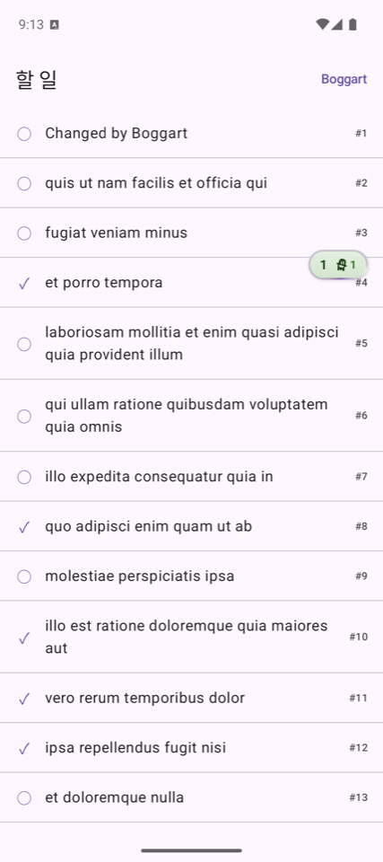
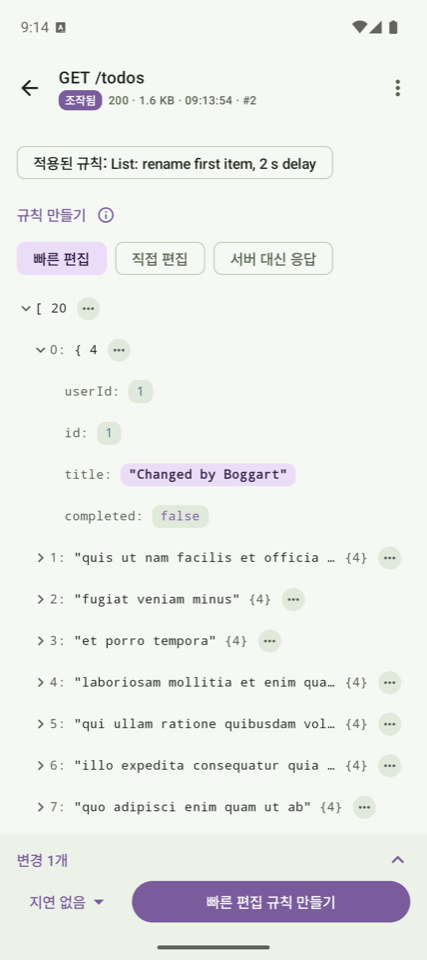
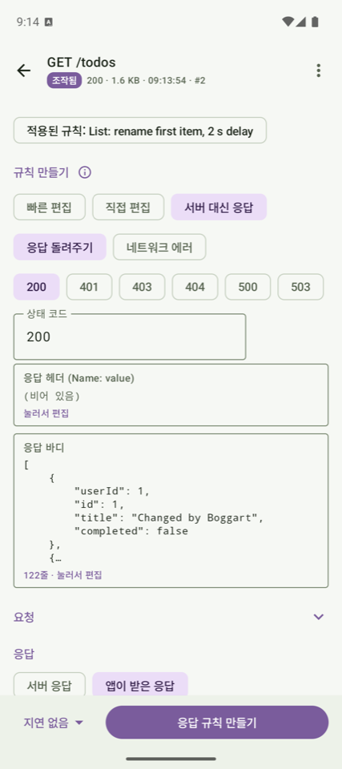
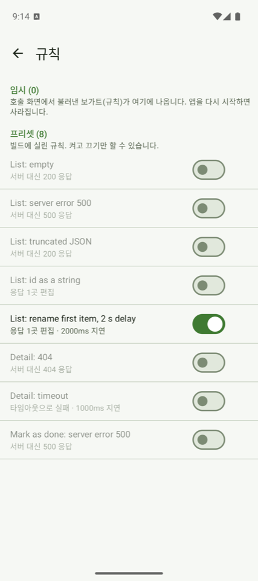

<p align="center">
  <picture>
    <source media="(prefers-color-scheme: dark)" srcset="docs/assets/boggart-dark.svg">
    
  </picture>
</p>

# Boggart

[English](README.md) · **한국어**

Boggart는 안드로이드 앱의 API 응답을 앱 안에서 실행 중에 바꾸는 라이브러리입니다. 개발자와 QA가 서버나 목 서버를 건드리지 않고 두려운 응답(빈 목록, 500, 깨진 JSON, 타임아웃)을 불러내 앱이 어떻게 버티는지 보고, 끝나면 되돌릴 수 있습니다.

- **실제 응답의 값 하나만 바꾸고** 나머지는 그대로 받습니다.
- **서버 대신 응답합니다.** 상태 코드·헤더·바디를 정해 돌려줍니다.
- **요청을 실패시킵니다.** 타임아웃, 연결 끊김, 네트워크 없음.

<table>
  <tr>
    <td></td>
    <td></td>
    <td></td>
    <td></td>
  </tr>
  <tr>
    <td>앱 위의 버블</td>
    <td>빠른 편집</td>
    <td>서버 대신 응답</td>
    <td>규칙</td>
  </tr>
</table>

보가트(Boggart)는 영국 민담에 나오는 존재로, Harry Potter에서는 보는 사람이 가장 두려워하는 모습으로 변신합니다. 앱이 두려워하는 응답을 일부러 불러내는 도구라서 이 이름을 붙였고, 규칙을 지우는 동작은 보가트를 물리치는 주문 이름을 따 `riddikulus`라고 부릅니다.

## 목차

- [빠른 시작](#빠른-시작)
- [첫 규칙 만들어 보기](#첫-규칙-만들어-보기)
- [응답을 바꾸는 방법 고르기](#응답을-바꾸는-방법-고르기)
- [규칙 관리](#규칙-관리)
- [QA 시나리오 모음](#qa-시나리오-모음)
- [프리셋: 빌드에 시나리오 싣기](#프리셋-빌드에-시나리오-싣기)
- [명령줄로 제어하기](#명령줄로-제어하기)
- [설정](#설정)
- [release 빌드](#release-빌드)
- [샘플 앱](#샘플-앱)
- [알려진 제약](#알려진-제약)
- [라이선스](#라이선스)

## 빠른 시작

### 요구사항

| 항목 | 값 |
|---|---|
| minSdk | 24 |
| compileSdk | 36 이상 (`ktor-client-okhttp` 3.6 이상을 쓰면 37 이상) |
| Kotlin | 2.x |
| HTTP 클라이언트 | OkHttp 5(Retrofit 포함) 또는 Ktor 3 |

### 1. 의존성 추가

Boggart는 Maven Central에 있습니다. debug에는 실제 구현을, release에는 아무 동작도 하지 않는 no-op 구현을 넣으면 앱 코드는 두 빌드에서 그대로 둘 수 있습니다.

```kotlin
dependencies {
    debugImplementation("io.github.hyunchan.boggart:boggart-android:0.1.1")
    debugImplementation("io.github.hyunchan.boggart:boggart-okhttp:0.1.1") // OkHttp·Retrofit을 쓰면
    debugImplementation("io.github.hyunchan.boggart:boggart-ktor:0.1.1")   // Ktor를 쓰면
    releaseImplementation("io.github.hyunchan.boggart:boggart-noop:0.1.1")
}
```

Boggart는 앱이 시작될 때 스스로 설치되므로 `Application`에 설치 코드를 넣지 않아도 됩니다.

`qa`·`staging` 같은 다른 빌드 타입에서도 쓰려면 같은 의존성을 그 빌드 타입의 설정(`"qaImplementation"(…)`)으로 넣고, 사용자에게 배포하는 빌드 타입에는 모두 `boggart-noop`을 넣습니다.

### 2. HTTP 클라이언트에 연결

**OkHttp·Retrofit**: 애플리케이션 인터셉터로 붙입니다(`addNetworkInterceptor`가 아님).

```kotlin
val okHttp = OkHttpClient.Builder()
    .addInterceptor(BoggartInterceptor())
    .build()

val retrofit = Retrofit.Builder()
    .baseUrl("https://api.example.com/")
    .client(okHttp)
    .build()
```

**Ktor**: 엔진을 감쌉니다. Ktor가 OkHttp 엔진을 써도 인터셉터를 따로 붙이지 않습니다. 둘 다 붙이면 호출이 두 번 잡힙니다.

```kotlin
val client = HttpClient(OkHttp.withBoggart()) {
    install(ContentNegotiation) { json() }
}
```

### 3. 앱 실행

debug 빌드를 실행하고 요청을 보내면 앱 위에 작은 버블이 떠서 Boggart가 캡처한 호출 수를 보여 줍니다. 버블을 누르면 Boggart가 열립니다. 코드에서는 `BoggartAndroid.openUi(context)`로 엽니다. 버블을 길게 누르면 규칙 목록으로 바로 가고, 끌어서 옮길 수 있습니다.

## 첫 규칙 만들어 보기

1. **호출 열기.** 버블을 누릅니다. 버블 숫자가 1이면 그 호출로 바로 가고, 2 이상이면 엔드포인트별로 묶인 호출 목록이 나옵니다.
2. **값 바꾸기.** 빠른 편집이 선택되어 있고 실제 응답이 트리로 보입니다. 값(예: `title`)을 누르고 새 값을 넣습니다.
3. **규칙 만들기.** 아래의 **빠른 편집 규칙 만들기**를 누르면 Boggart가 닫히고 앱으로 돌아갑니다.
4. **앱에서 다시 불러오기.** 규칙은 다음 요청부터 적용되므로 당겨서 새로고침하거나 화면을 다시 엽니다. 버블에 보가트 얼굴과 켜진 규칙 수가 나오고, 새로 불러온 호출에는 **조작됨**이 붙습니다. 조작됨은 Boggart가 그 호출에 규칙을 적용했다는 표시로, 앱이 결과를 제대로 처리했는지와는 무관합니다.
5. **되돌리기.** **규칙**을 열고 임시 섹션의 **모두 지우기**를 누른 뒤 리디큘러스! 다이얼로그에서 **확인**을 누릅니다. 화면에서 만든 규칙은 임시 규칙이라 앱을 다시 시작해도 사라집니다.

## 응답을 바꾸는 방법 고르기

| | 하는 일 | 이럴 때 |
|---|---|---|
| **빠른 편집** | 실제 응답 트리에서 값을 고치거나 지웁니다. 배열은 비우거나, 처음 몇 개만 남기거나, 항목 하나를 지울 수 있습니다 | 실제 응답에서 한 가지만 다르게: 긴 제목, 빠진 필드, 빈 목록 |
| **직접 편집** | 응답 바디를 텍스트로 고칩니다. 바꾼 부분만 규칙이 되고 나머지는 실제 응답 그대로입니다. 배열은 바꾸면 통째로 교체됩니다 | 누르기보다 타이핑이 빠른 큰 변경 |
| **서버 대신 응답** | 서버를 부르지 않고, **응답 돌려주기**(상태 코드·헤더·바디)와 **네트워크 에러**(타임아웃, 연결 끊김, 호스트 없음, 직접 쓴 메시지의 `IOException`) 중 하나를 고릅니다 | 오류 상태 코드, 깨진 바디, 실패, 아직 없는 엔드포인트 |

어떤 규칙에나 지연을 붙일 수 있습니다. 앱에서는 **규칙 만들기** 옆 ⓘ에서 세 가지 방법의 설명을 볼 수 있습니다.

빠른 편집·직접 편집은 JSON 응답에만 쓸 수 있고, 그 밖의 응답은 **서버 대신 응답**을 씁니다. 편집한 바디는 전달 전에 검증하고, 검증에 실패하면(기본은 올바른 JSON이 아닐 때) 앱에는 원래 응답이 가고 그 호출은 **적용 안 됨**으로 표시됩니다. 앱이 깨진 JSON을 받게 하려면 **서버 대신 응답**에 깨진 바디를 넣습니다.

호출에서 만든 규칙은 그 호출의 메서드·호스트·경로에 맞춰집니다. 쿼리·헤더 조건을 포함한 매칭 조건은 규칙 편집 화면에서 바꿀 수 있습니다.

## 규칙 관리

규칙은 세 곳에서 옵니다.

| 출처 | 어디서 | 수명 |
|---|---|---|
| **임시** | 앱에서 호출을 보고 만든 규칙 | 앱을 다시 시작할 때까지. **저장**하면 남습니다 |
| **저장됨** | 저장한 임시 규칙 | 재시작 후에도 남습니다 |
| **프리셋** | debug 에셋의 `rules.json` | 빌드에 실립니다. 켜고 끄기만 할 수 있습니다 |

- **요청마다 규칙 하나.** 임시 → 저장됨 → 프리셋 순으로 보며, 켜져 있고 조건이 맞는 첫 규칙 하나만 적용합니다. 같은 출처 안에서는 먼저 있는 규칙이 이깁니다. 앞선 규칙에 조건이 완전히 덮여 적용될 일이 없는 규칙은 규칙 목록에 **가려짐**으로 표시됩니다.
- **규칙 지우기(리디큘러스).** **모두 지우기**로 임시 규칙을 한 번에 지우고, 규칙 하나는 줄 끝 ⋮ 메뉴로 지웁니다. 코드에서는 `Boggart.riddikulus()` 또는 `Boggart.riddikulus(ruleId)`([release 빌드](#release-빌드) 참고).
- **모드.** 호출 목록 위에서 바꿉니다.

| 모드 | 화면 이름 | 동작 | 이럴 때 |
|---|---|---|---|
| `Active` (기본) | 규칙 적용 | 규칙과 맞는 호출만 바꾸고 나머지는 실제 응답 그대로 | 평소 |
| `Paused` | 규칙 일시정지 | 규칙을 지우지 않고 멈춤. 호출은 계속 기록 | 규칙 적용 전후 비교, 서버 수정 확인 |
| `Offline` | 오프라인 | 규칙과 맞는 호출만 응답하고, 나머지는 `UnknownHostException`으로 실패 | 오프라인 화면 확인, 서버 없이 미리 만든 응답만으로 개발 |
| `Off` | 끔 | 바꾸지도 기록하지도 않음. 코드로만 지정 | Boggart가 원인인지 가려낼 때 |

## QA 시나리오 모음

| 앱이 이런 상황을 어떻게 처리하는지 보려면 | 이렇게 |
|---|---|
| 빈 목록 | 빠른 편집: 배열의 ⋯ → **빈 배열로** |
| 짧은 목록 | 빠른 편집: 배열의 ⋯ → **처음 몇 개만 남기기** |
| 빠지거나 형식이 틀린 필드 | 빠른 편집: 값을 눌러 지우거나 형식을 바꿈(예: 숫자 → 문자열) |
| 서버 오류 | 서버 대신 응답 → 응답 돌려주기 → 500 (또는 401, 403, 404, 503) |
| 앱이 파싱할 수 없는 응답 | 서버 대신 응답 → 응답 돌려주기에 깨진 바디 |
| 타임아웃 | 서버 대신 응답 → 네트워크 에러 → 타임아웃 |
| 네트워크 없음 | 모드 → 오프라인 |
| 느린 응답 | 어떤 규칙에든 지연을 붙임 |

[샘플 앱](#샘플-앱)에는 이 중 대부분이 프리셋으로 들어 있습니다.

## 프리셋: 빌드에 시나리오 싣기

debug 소스셋에 규칙을 두면 팀과 시나리오를 공유할 수 있습니다. **프리셋**에 나옵니다.

```
src/debug/assets/boggart/rules.json
src/debug/assets/boggart/bodies/user-404.json
```

```json
{
  "rules": [
    {
      "id": "user-404",
      "name": "사용자 없음",
      "matcher": { "method": "GET", "path": "/api/v1/users/*" },
      "override": { "type": "replace", "status": 404, "bodyFile": "user-404.json", "delayMs": 500 },
      "enabled": false
    },
    {
      "id": "first-title",
      "name": "첫 기사 제목 바꾸기",
      "matcher": { "method": "GET", "path": "/api/v1/feed" },
      "override": { "type": "jsonPatch", "ops": [
        { "op": "replace", "path": "/0/title", "value": "Boggart" },
        { "op": "remove", "path": "/1" }
      ] },
      "enabled": false
    },
    {
      "id": "profile-patch",
      "name": "프로필 이름 바꾸기",
      "matcher": { "path": "/api/v1/me" },
      "override": { "type": "patch", "patch": { "name": "Boggart", "avatar": null } },
      "enabled": false
    },
    {
      "id": "checkout-timeout",
      "name": "결제 타임아웃",
      "matcher": { "method": "POST", "path": "/api/v1/checkout/**" },
      "override": { "type": "fail", "kind": { "type": "timeout" }, "delayMs": 3000 },
      "enabled": false
    }
  ]
}
```

| 필드 | 설명 |
|---|---|
| `version` | 선택. 파일 형식 버전이며 지금은 `1`뿐이라 생략해도 됩니다 |
| `id` | 파일 안에서 고유해야 합니다. 프리셋을 켰는지는 id로 기억합니다 |
| `name` | 규칙 목록에 보이는 이름. 비우면 id |
| `enabled` | 처음부터 켜 둘지. 기본값 `true` |
| `matcher.path` | 경로 글롭. `*`는 한 세그먼트, `**`는 0개 이상. 끝 슬래시는 구분하지 않습니다 |
| `matcher.method` / `host` | 대소문자 무시. 비우면 모두 매칭 |
| `matcher.query` / `headers` | `{"이름": "값"}`. 값이 `*`이면 존재만 검사 |
| `override.type` | `jsonPatch`(빠른 편집) / `patch`(직접 편집) / `replace`(응답 돌려주기) / `fail`(네트워크 에러) |
| `override.ops` (`jsonPatch`) | `{"op": "add" \| "remove" \| "replace", "path": "/0/title", "value": …}` 배열(JSON Patch, RFC 6902). 경로는 JSON Pointer(RFC 6901). 하나라도 적용할 수 없으면 패치 전체를 버리고 원본을 전달합니다 |
| `override.patch` (`patch`) | 바꿀 필드만 적습니다(JSON Merge Patch, RFC 7396). 값이 `null`이면 그 필드를 지우고, 배열은 통째로 교체합니다 |
| `override.status` / `headers` / `body` / `bodyFile` (`replace`) | 돌려줄 응답. `bodyFile`은 `bodies/` 아래 파일명이고 `body`와 함께 쓸 수 없습니다 |
| `override.kind.type` (`fail`) | `timeout` / `connectionReset` / `unknownHost` / `custom`(`message`) |
| `override.delayMs` | 어떤 규칙에나 붙일 수 있는 지연 |

`"enabled": true`인 프리셋은 그 빌드를 설치한 모두에게 처음부터 켜지므로, `false`로 두고 앱에서 켜기를 권장합니다. 켜고 끈 상태는 기억됩니다.

프리셋과 저장 규칙은 앱의 첫 요청부터 적용됩니다. Boggart는 앱이 시작될 때 이 규칙들을 읽고, 다 읽기 전에 나간 요청은 최대 0.5초까지 기다립니다.

## 명령줄로 제어하기

화면에서 하는 일은 UI 없이 adb로도 할 수 있습니다. 명령은 모두 JSON을 주고받으므로 AI 에이전트나 테스트 스크립트가 Boggart를 직접 다룰 수 있습니다. 앱이 보낸 호출을 확인하고, 규칙을 추가·수정하고, 프리셋을 켜고 끄고, 모드를 바꿀 수 있습니다.

debug 앱이 시작되면 Boggart가 로컬 소켓을 엽니다. 기기마다 한 번 컴퓨터로 포워딩한 뒤 `curl`로 부릅니다.

```bash
adb forward tcp:8765 localabstract:boggart-<applicationId>
curl localhost:8765/            # 모든 명령과 파라미터
curl localhost:8765/status
```

정확한 `adb forward` 명령은 logcat의 `Boggart` 태그에도 찍힙니다. adb shell과 앱 자신만 연결할 수 있고, 기기의 다른 앱은 거절합니다.

| 명령 | 하는 일 |
|---|---|
| `GET /status` | 모드, 규칙 수, 마지막으로 캡처한 호출 id(`lastId`) |
| `GET /calls?since=&method=&host=&path=&limit=` | 바디를 뺀 호출 목록. `path`는 규칙과 같은 글롭 |
| `GET /calls/{id}` | 호출 하나의 요청, 서버 응답, 앱이 받은 응답 |
| `GET /calls/wait?since=&path=&timeoutMs=` | 조건에 맞는 호출이 올 때까지 기다렸다가 돌려줌. 시간 안에 안 오면 408 |
| `DELETE /calls` | 캡처한 호출 비우기 |
| `GET /rules?source=` | 적용을 시도하는 순서대로 규칙 목록. `source`는 `temporary`·`saved`·`preset`·`other` |
| `PUT /rules/{id}?target=` | 규칙 만들기·바꾸기. 바디는 `rules.json`의 규칙 하나. `target`은 `temporary`(기본) 또는 `saved` |
| `PATCH /rules/{id}` | `{"enabled": false}`로 끄기. 프리셋도 됨 |
| `DELETE /rules/{id}` | 임시·저장 규칙 지우기 |
| `POST /rules/import?target=&replace=` | 규칙 문서를 한 번에 적용(테스트 시나리오 단위) |
| `GET /mode`, `PUT /mode` | `{"mode": "offline"}`. `active`·`paused`·`offline`·`off` 중 하나 |
| `POST /reset` | 임시 규칙 해제, 캡처한 호출 비우기, 모드를 `active`로 |

테스트 한 단계의 예:

```bash
# 1. 사용자 API를 실패시키기
curl -X PUT localhost:8765/rules/user-500 -d '{"matcher":{"path":"/users/*"},"override":{"type":"replace","status":500}}'

# 2. 마지막 호출 id를 기억하고, 앱에서 화면을 연 뒤 그 호출을 기다리기
since=$(curl -s localhost:8765/status | jq .calls.lastId)
curl "localhost:8765/calls/wait?since=$since&path=/users/*&timeoutMs=10000"

# 3. 다음 테스트 전에 정리
curl -X POST localhost:8765/reset
```

`/calls/wait`에는 `since`를 넘겨야 기다리기 전에 이미 나간 호출을 놓치지 않습니다. 실패하면 2xx가 아닌 상태와 `{"error": {"code", "message"}}`를 돌려줍니다. 원격 제어를 끄려면 `remoteControl = false`로 둡니다([설정](#설정) 참고).

## 설정

Boggart는 아래 기본값으로 시작합니다. 바꾸려면 `Application`에서 `BoggartAndroid.configure`를 부릅니다. 적지 않은 항목은 기본값 그대로입니다.

```kotlin
class App : Application() {
    override fun onCreate() {
        super.onCreate()
        BoggartAndroid.configure {
            mode = Mode.Active       // Active / Paused / Offline / Off
            overlay = true           // 버블 표시
            overlayWindowMs = 2_000  // 이 시간 안에 이어진 호출을 한 묶음으로 세어 버블에 표시
            assetsDir = "boggart"    // assets/<assetsDir>/rules.json
            loadAssets = true        // 프리셋 불러오기
            persistence = true       // 저장 규칙과 프리셋 켜짐 상태를 재시작 후에도 유지
            remoteControl = true     // adb로 명령 받기(위 참고)
        }
    }
}
```

- **바디 크기.** 1 MiB를 넘는 바디는 캡처하지 않고 빠른 편집·직접 편집도 적용하지 않습니다. 서버 대신 응답은 그대로 적용됩니다. 한도는 `BoggartInterceptor(maxBodyBytes = …)`, `OkHttp.withBoggart(maxBodyBytes = …)`로 바꾸며, 항상 이름 있는 인자(named argument)로 넘깁니다.
- **더 엄격한 검증.** 기본으로는 편집한 바디가 올바른 JSON이기만 하면 됩니다. 스키마로 검증하려면 debug 코드에서 `Boggart.configure { validator = BodyValidator { body, mediaType -> … } }`로 검증기를 지정합니다. `Boggart.configure`는 이런 엔진 설정을 바꾸고, 설치 설정은 위의 `BoggartAndroid.configure`에서 바꿉니다. 규칙 편집 화면에서 **검증에 실패하면 원본 전달**을 끄면 검증에 어긋난 바디도 그대로 전달합니다.
- **캡처한 호출.** 최근 200건을 메모리에만 두며 앱을 다시 시작하면 사라집니다. 저장 규칙과 프리셋 켜짐 상태는 앱 전용 저장소에 둡니다.
- **언어.** 기기 언어가 한국어면 한국어로, 그 밖에는 영어로 나옵니다.
- **리소스.** 리소스 이름은 모두 `boggart_`로 시작해 앱 리소스와 겹치지 않습니다.

### 자동 설치 끄기

Boggart는 [App Startup](https://developer.android.com/topic/libraries/app-startup)으로 스스로 설치됩니다. 일부 프로세스에서만 쓰는 등 직접 설치하려면 debug 매니페스트에서 초기화 항목을 지우고, 원하는 곳에서 `BoggartAndroid.install(context) { … }`를 부릅니다. 이때는 앱이 첫 요청을 보내기 전에 설치해야 합니다.

앱이 이미 App Startup의 `InitializationProvider`를 통째로 지워 두었다면(예: WorkManager를 직접 초기화하는 앱) Boggart도 자동으로 설치되지 않습니다. `Application`에서 `BoggartAndroid.install(this)`를 부르세요.

```xml
<!-- src/debug/AndroidManifest.xml -->
<manifest xmlns:android="http://schemas.android.com/apk/res/android"
    xmlns:tools="http://schemas.android.com/tools">
    <application>
        <provider
            android:name="androidx.startup.InitializationProvider"
            android:authorities="${applicationId}.androidx-startup"
            tools:node="merge">
            <meta-data
                android:name="io.github.hyunchan.boggart.android.BoggartInitializer"
                tools:node="remove" />
        </provider>
    </application>
</manifest>
```

## release 빌드

`boggart-noop`은 `BoggartAndroid`(`configure`, `install`, `openUi`), `BoggartInterceptor`, `withBoggart`, `Mode`를 no-op으로 제공하므로, 위의 코드는 release 빌드에서도 그대로 컴파일됩니다. 아무것도 설치하지 않습니다.

그 밖의 API(규칙·검증을 코드로 다루는 `Boggart`, `Rule`, `BodyValidator` 등)는 debug용 아티팩트에만 있습니다. 이를 쓰는 코드는 debug 소스셋에 두어야 release 빌드가 컴파일됩니다.

## 샘플 앱

`sample` 모듈은 공개 테스트 API [JSONPlaceholder](https://jsonplaceholder.typicode.com/)를 호출하는 작은 할 일 앱입니다. 빈 목록·서버 오류·파싱 실패·연결 실패마다 다른 화면이 있고, 각 화면을 띄우는 프리셋이 들어 있습니다.

```bash
./gradlew :sample:installDebug
```

오른쪽 위 **Boggart** → **규칙**에서 프리셋을 하나 켜고, 목록을 당겨 새로고침하거나 할 일을 열어 보세요.

## 알려진 제약

- **헤더 매칭이 클라이언트마다 다릅니다.** OkHttp에서는 앱이 직접 넣은 헤더만 보이고, OkHttp가 나중에 붙이는 `Content-Type`·`User-Agent` 등은 보이지 않습니다. Ktor에서는 플러그인이 붙인 헤더까지 보입니다. 헤더 조건은 인증·커스텀 헤더에 쓰기를 권장합니다.
- **Ktor 엔진 인스턴스.** 엔진 인스턴스를 감싸면(`HttpClient(engine.withBoggart())`) Ktor 관례대로 클라이언트가 엔진을 닫지 않습니다. 팩토리를 감싸면(`HttpClient(OkHttp.withBoggart())`) 클라이언트가 닫습니다.
- **다이얼로그 위 버블.** 버블은 다이얼로그·바텀시트 위에는 보이지 않습니다. 닫은 뒤 누르거나 `BoggartAndroid.openUi(context)`로 여세요.
- **스트리밍·대용량 응답.** `text/event-stream` 응답과 바디 한도를 넘는 응답은 캡처하거나 편집할 수 없습니다. 서버 대신 응답은 쓸 수 있습니다.

## 라이선스

Boggart는 독립 프로젝트이며 J.K. Rowling, Warner Bros., Harry Potter 프랜차이즈와 관련이 없고 그들의 승인을 받지 않았습니다.

```
Copyright 2026 hyunchan

Licensed under the Apache License, Version 2.0 (the "License");
you may not use this file except in compliance with the License.
You may obtain a copy of the License at

    http://www.apache.org/licenses/LICENSE-2.0

Unless required by applicable law or agreed to in writing, software
distributed under the License is distributed on an "AS IS" BASIS,
WITHOUT WARRANTIES OR CONDITIONS OF ANY KIND, either express or implied.
See the License for the specific language governing permissions and
limitations under the License.
```
