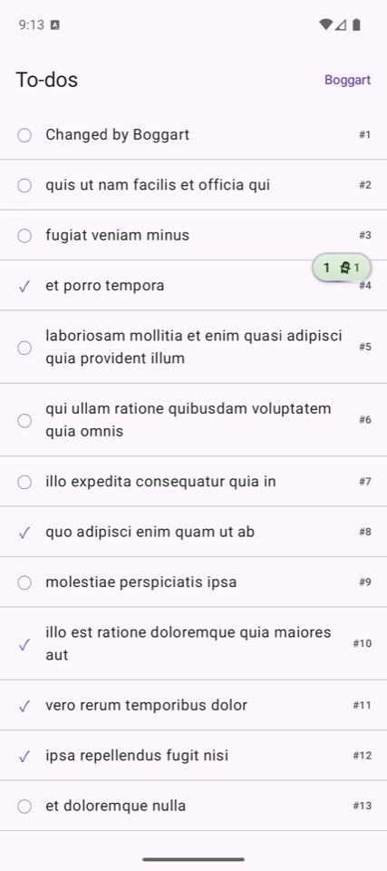
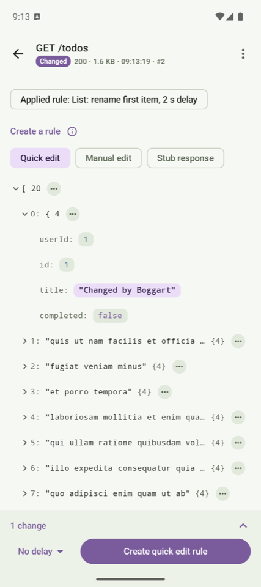
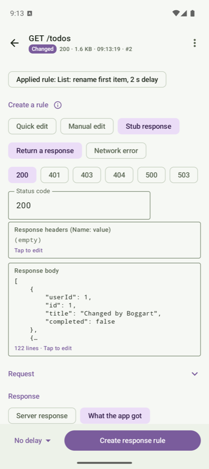
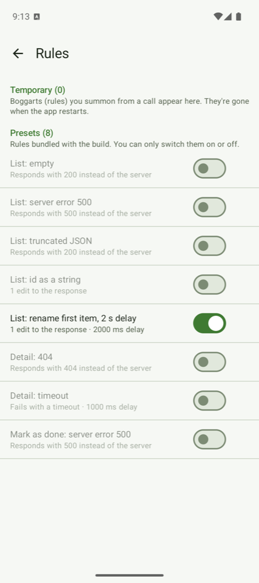

<p align="center">
  <picture>
    <source media="(prefers-color-scheme: dark)" srcset="docs/assets/boggart-dark.svg">
    
  </picture>
</p>

# Boggart

**English** · [한국어](README.ko.md)

Boggart lets you change your Android app's API responses at runtime, from inside the app. Developers and QA can summon the responses they dread (an empty list, a 500, broken JSON, a timeout) without touching the server or setting up a mock server, see how the app copes, and undo them when you're done.

- **Change one value** in a real response and keep everything else live.
- **Answer instead of the server** with a status, headers and body you choose.
- **Make the request fail** with a timeout, a dropped connection or no network.

<table>
  <tr>
    <td></td>
    <td></td>
    <td></td>
    <td></td>
  </tr>
  <tr>
    <td>The bubble over your app</td>
    <td>Quick edit</td>
    <td>Stub response</td>
    <td>Rules</td>
  </tr>
</table>

A boggart is a creature from British folklore; in Harry Potter it takes the shape of whatever its viewer fears most. Boggart brings your app's feared responses to life on purpose, and turning them off is called `riddikulus`, after the spell that defeats one.

## Contents

- [Quick start](#quick-start)
- [Your first rule](#your-first-rule)
- [Choosing how to change a response](#choosing-how-to-change-a-response)
- [Managing rules](#managing-rules)
- [QA recipes](#qa-recipes)
- [Presets: shipping scenarios with the build](#presets-shipping-scenarios-with-the-build)
- [Controlling Boggart from the command line](#controlling-boggart-from-the-command-line)
- [Configuration](#configuration)
- [Release builds](#release-builds)
- [Sample app](#sample-app)
- [Known limitations](#known-limitations)
- [Licence](#licence)

## Quick start

### Requirements

| Requirement | Version |
|---|---|
| minSdk | 24 |
| compileSdk | 36 or higher (37 or higher with `ktor-client-okhttp` 3.6 or later) |
| Kotlin | 2.x |
| HTTP client | OkHttp 5 (including Retrofit) or Ktor 3 |

### 1. Add the dependencies

Boggart is on Maven Central. Use the real implementation in debug builds and the no-op one in release builds, so your app code stays the same for both.

```kotlin
dependencies {
    debugImplementation("io.github.hyunchan.boggart:boggart-android:0.1.1")
    debugImplementation("io.github.hyunchan.boggart:boggart-okhttp:0.1.1") // if you use OkHttp or Retrofit
    debugImplementation("io.github.hyunchan.boggart:boggart-ktor:0.1.1")   // if you use Ktor
    releaseImplementation("io.github.hyunchan.boggart:boggart-noop:0.1.1")
}
```

Boggart installs itself when the app starts, so you don't need any setup code in your `Application`.

To use Boggart in another build type, such as `qa` or `staging`, add the same dependencies with that build type's configuration (`"qaImplementation"(…)`), and use `boggart-noop` for every build type you ship to users.

### 2. Attach it to your HTTP client

**OkHttp and Retrofit**: add it as an application interceptor, not with `addNetworkInterceptor`.

```kotlin
val okHttp = OkHttpClient.Builder()
    .addInterceptor(BoggartInterceptor())
    .build()

val retrofit = Retrofit.Builder()
    .baseUrl("https://api.example.com/")
    .client(okHttp)
    .build()
```

**Ktor**: wrap the engine. Even if Ktor uses the OkHttp engine, don't add the interceptor as well, or every call is captured twice.

```kotlin
val client = HttpClient(OkHttp.withBoggart()) {
    install(ContentNegotiation) { json() }
}
```

### 3. Run the app

Run a debug build and make a request. A small bubble appears over your app with the number of calls Boggart captured. Tap it to open Boggart, or open it from code with `BoggartAndroid.openUi(context)`. Long-press the bubble to go straight to your rules, and drag it to move it.

## Your first rule

1. **Open the call.** Tap the bubble. If it shows 1, you land on that call directly; if it shows more, you see the call list, grouped by endpoint.
2. **Change a value.** Quick edit is selected and shows the real response as a tree. Tap a value, for example a `title`, and enter a new one.
3. **Create the rule.** Tap **Create quick edit rule** at the bottom. Boggart closes and you're back in your app.
4. **Reload in the app.** Rules apply from the next request, so pull to refresh or reopen the screen. The bubble now shows the Boggart face with the number of rules switched on, and the new call is marked **Changed**. Changed means Boggart applied a rule to the call, whether or not the app could handle the result.
5. **Undo it.** Open **Rules**, tap **Clear all** under Temporary, then **OK** in the Riddikulus! dialog. Rules you create are temporary, so they also disappear when the app restarts.

## Choosing how to change a response

| | What it does | Use it when |
|---|---|---|
| **Quick edit** | Change, remove or replace values in the real response tree. An array can be emptied, cut down to its first few items, or lose one item | You want the real response with one thing different: a long title, a missing field, an empty list |
| **Manual edit** | Edit the response body as text. Boggart keeps only what you changed, so the rest stays live. A changed array is replaced whole | Bigger reshaping that is quicker to type than to tap |
| **Stub response** | Don't call the server. Either **Return a response** (status, headers, body) or raise a **Network error** (timeout, connection reset, unknown host, or an `IOException` with your own message) | Error statuses, broken bodies, failures, or endpoints that don't exist yet |

Any rule can add a delay. The ⓘ next to **Create a rule** explains all three in the app.

Quick edit and manual edit work on JSON responses only; for anything else, use **Stub response**. An edited body is validated before it's delivered. If it fails (by default, if it isn't valid JSON), the app gets the original response and the call is marked **Not applied**. To make the app receive broken JSON on purpose, use **Stub response** with a broken body.

A rule created from a call matches that call's method, host and path. You can change the match, including query and header conditions, in the rule editor.

## Managing rules

Rules come from three places.

| Source | Where it comes from | Lifetime |
|---|---|---|
| **Temporary** | Created from a call in the app | Until the app restarts. **Save** keeps it |
| **Saved** | A temporary rule you saved | Survives restarts |
| **Presets** | `rules.json` in your debug assets | Ships with the build. You can only switch them on or off |

- **One rule per request.** Boggart looks in Temporary, then Saved, then Presets, and applies the first rule that's switched on and matches. Within a source, the earlier rule wins. A rule that can never apply because an earlier one fully covers it is marked **Shadowed** in the rule list.
- **Removing rules (riddikulus).** **Clear all** removes every temporary rule at once; the ⋮ menu on a rule removes just that one. In code: `Boggart.riddikulus()` or `Boggart.riddikulus(ruleId)` (see [Release builds](#release-builds)).
- **Modes.** Switch them from the top of the call list.

| Mode | Shown as | What happens | Use it to |
|---|---|---|---|
| `Active` (default) | Rules on | Calls that match a rule are changed; everything else is real | Test day to day |
| `Paused` | Rules paused | Rules are kept but not applied. Calls are still recorded | Compare before and after, or check a server fix |
| `Offline` | Offline | Calls that match a rule are answered; all others fail with `UnknownHostException` | Check offline screens, or build against prepared responses only |
| `Off` | Off | Nothing is changed or recorded. Can only be set in code | Rule Boggart out as the cause of a problem |

## QA recipes

| To see how the app handles… | Do this |
|---|---|
| An empty list | Quick edit: ⋯ on the array → **Make it an empty array** |
| A shorter list | Quick edit: ⋯ on the array → **Keep only the first few** |
| A missing or wrongly typed field | Quick edit: tap the value, then remove it or change its type (for example a number to text) |
| A server error | Stub response → Return a response → 500 (or 401, 403, 404, 503) |
| A response the app can't parse | Stub response → Return a response, with a broken body |
| A timeout | Stub response → Network error → Timeout |
| No network | Mode → Offline |
| A slow response | Any rule, with a delay |

The [sample app](#sample-app) ships a preset for most of these.

## Presets: shipping scenarios with the build

Put rules in your debug source set to share scenarios with your team. They appear under **Presets**.

```
src/debug/assets/boggart/rules.json
src/debug/assets/boggart/bodies/user-404.json
```

```json
{
  "rules": [
    {
      "id": "user-404",
      "name": "User not found",
      "matcher": { "method": "GET", "path": "/api/v1/users/*" },
      "override": { "type": "replace", "status": 404, "bodyFile": "user-404.json", "delayMs": 500 },
      "enabled": false
    },
    {
      "id": "first-title",
      "name": "Rename the first article",
      "matcher": { "method": "GET", "path": "/api/v1/feed" },
      "override": { "type": "jsonPatch", "ops": [
        { "op": "replace", "path": "/0/title", "value": "Boggart" },
        { "op": "remove", "path": "/1" }
      ] },
      "enabled": false
    },
    {
      "id": "profile-patch",
      "name": "Change the profile name",
      "matcher": { "path": "/api/v1/me" },
      "override": { "type": "patch", "patch": { "name": "Boggart", "avatar": null } },
      "enabled": false
    },
    {
      "id": "checkout-timeout",
      "name": "Checkout times out",
      "matcher": { "method": "POST", "path": "/api/v1/checkout/**" },
      "override": { "type": "fail", "kind": { "type": "timeout" }, "delayMs": 3000 },
      "enabled": false
    }
  ]
}
```

| Field | Meaning |
|---|---|
| `version` | Optional. The file format version; there is only `1` so far, so you can leave it out |
| `id` | Unique within the file. Boggart remembers whether a preset is switched on by its id |
| `name` | Shown in the rule list. Defaults to the id |
| `enabled` | Whether the preset starts switched on. Defaults to `true` |
| `matcher.path` | Path glob. `*` matches one segment, `**` zero or more. A trailing slash doesn't matter |
| `matcher.method` / `host` | Case-insensitive. Leave out to match any |
| `matcher.query` / `headers` | `{"name": "value"}`. A value of `*` only checks that it's present |
| `override.type` | `jsonPatch` (quick edit) / `patch` (manual edit) / `replace` (return a response) / `fail` (network error) |
| `override.ops` (`jsonPatch`) | Array of `{"op": "add" \| "remove" \| "replace", "path": "/0/title", "value": …}` (JSON Patch, RFC 6902). Paths are JSON Pointers (RFC 6901). If any op can't be applied, the whole patch is dropped and the original is delivered |
| `override.patch` (`patch`) | The fields to change (JSON Merge Patch, RFC 7396). A `null` value removes the field; arrays are replaced whole |
| `override.status` / `headers` / `body` / `bodyFile` (`replace`) | The response to return. `bodyFile` is a file name under `bodies/` and can't be combined with `body` |
| `override.kind.type` (`fail`) | `timeout` / `connectionReset` / `unknownHost` / `custom` (with `message`) |
| `override.delayMs` | Optional delay for any override |

A preset with `"enabled": true` is on for everyone who installs the build, so keep presets at `false` and switch them on in the app. Boggart remembers which ones you switched on.

Presets and saved rules apply from the app's very first request. Boggart reads them when the app starts, and a request made before they're ready waits for them, for up to 0.5 seconds.

## Controlling Boggart from the command line

Everything the screens do can also be done over adb, without touching the UI. Each command takes and returns JSON, so AI agents and test scripts can drive Boggart directly: check which calls the app made, add or change rules, switch presets on and off, and change the mode.

Boggart opens a local socket when the debug app starts. Forward it to your computer once per device, then use `curl`:

```bash
adb forward tcp:8765 localabstract:boggart-<applicationId>
curl localhost:8765/            # every command with its parameters
curl localhost:8765/status
```

The exact `adb forward` line is also printed to logcat under the `Boggart` tag. Only adb shell and the app itself can connect; other apps on the device are refused.

| Command | What it does |
|---|---|
| `GET /status` | Mode, rule counts, and `lastId`, the id of the latest captured call |
| `GET /calls?since=&method=&host=&path=&limit=` | Captured calls without bodies. `path` is a glob as in rules |
| `GET /calls/{id}` | One call with its request, the server's response and the response the app received |
| `GET /calls/wait?since=&path=&timeoutMs=` | Waits for a matching call and returns it. Answers 408 if none arrives in time |
| `DELETE /calls` | Clears captured calls |
| `GET /rules?source=` | Rules in the order they're tried. `source` is `temporary`, `saved`, `preset` or `other` |
| `PUT /rules/{id}?target=` | Creates or replaces a rule. The body is a rule as in `rules.json`. `target` is `temporary` (default) or `saved` |
| `PATCH /rules/{id}` | `{"enabled": false}` turns a rule off. Works for presets too |
| `DELETE /rules/{id}` | Deletes a temporary or saved rule |
| `POST /rules/import?target=&replace=` | Applies a whole rules document, e.g. one test scenario |
| `GET /mode`, `PUT /mode` | `{"mode": "offline"}`. One of `active`, `paused`, `offline`, `off` |
| `POST /reset` | Removes temporary rules, clears captured calls and sets the mode back to `active` |

A typical test step:

```bash
# 1. Make the user endpoint fail
curl -X PUT localhost:8765/rules/user-500 -d '{"matcher":{"path":"/users/*"},"override":{"type":"replace","status":500}}'

# 2. Note the latest call id, trigger the screen in the app, then wait for the call
since=$(curl -s localhost:8765/status | jq .calls.lastId)
curl "localhost:8765/calls/wait?since=$since&path=/users/*&timeoutMs=10000"

# 3. Clean up before the next test
curl -X POST localhost:8765/reset
```

Pass `since` to `/calls/wait` so that a call made before the wait starts isn't missed. Failures return a non-2xx status with `{"error": {"code", "message"}}`. To turn remote control off, set `remoteControl = false` (see [Configuration](#configuration)).

## Configuration

Boggart starts with the defaults below. To change them, call `BoggartAndroid.configure` in your `Application`. Settings you leave out keep their defaults.

```kotlin
class App : Application() {
    override fun onCreate() {
        super.onCreate()
        BoggartAndroid.configure {
            mode = Mode.Active       // Active / Paused / Offline / Off
            overlay = true           // show the bubble
            overlayWindowMs = 2_000  // calls within this time of each other are counted on the bubble as one batch
            assetsDir = "boggart"    // assets/<assetsDir>/rules.json
            loadAssets = true        // load presets
            persistence = true       // keep saved rules and preset switches across restarts
            remoteControl = true     // accept commands over adb (see above)
        }
    }
}
```

- **Body size.** Bodies over 1 MiB aren't captured, and quick and manual edits aren't applied to them. Stub responses still work. Change the limit with `BoggartInterceptor(maxBodyBytes = …)` or `OkHttp.withBoggart(maxBodyBytes = …)`. Always pass it by name.
- **Stricter validation.** By default an edited body only has to be valid JSON. To check it against your own schema, set a validator in debug code with `Boggart.configure { validator = BodyValidator { body, mediaType -> … } }`. `Boggart.configure` changes engine settings such as this one; installation settings stay in `BoggartAndroid.configure` above. In the rule editor, untick **Pass the original on if validation fails** to deliver bodies that fail it.
- **Captured calls.** The last 200 calls are kept in memory only and are gone when the app restarts. Saved rules and preset switches are stored in the app's private storage.
- **Language.** The screens are in Korean on Korean devices and in English otherwise.
- **Resources.** All resource names start with `boggart_`, so they won't clash with yours.

### Turning off automatic installation

Boggart installs itself through [App Startup](https://developer.android.com/topic/libraries/app-startup). To install it yourself instead, for example only in some processes, remove its initializer in your debug manifest and call `BoggartAndroid.install(context) { … }` where you want it. Install it before your app makes its first request.

If your app already removes App Startup's `InitializationProvider` entirely, for example to initialise WorkManager yourself, Boggart won't install itself either. Call `BoggartAndroid.install(this)` in your `Application`.

```xml
<!-- src/debug/AndroidManifest.xml -->
<manifest xmlns:android="http://schemas.android.com/apk/res/android"
    xmlns:tools="http://schemas.android.com/tools">
    <application>
        <provider
            android:name="androidx.startup.InitializationProvider"
            android:authorities="${applicationId}.androidx-startup"
            tools:node="merge">
            <meta-data
                android:name="io.github.hyunchan.boggart.android.BoggartInitializer"
                tools:node="remove" />
        </provider>
    </application>
</manifest>
```

## Release builds

`boggart-noop` provides `BoggartAndroid` (`configure`, `install`, `openUi`), `BoggartInterceptor`, `withBoggart` and `Mode` as no-ops, so the code above compiles in release builds unchanged. It doesn't install anything.

Everything else, such as `Boggart` (rules and validation from code), `Rule` and `BodyValidator`, exists only in the debug artifacts. Code that uses them has to live in the debug source set, or the release build won't compile.

## Sample app

The `sample` module is a small to-do app that calls the public test API [JSONPlaceholder](https://jsonplaceholder.typicode.com/). It has a separate screen for an empty list, a server error, a parse failure and a connection failure, with a preset that triggers each.

```bash
./gradlew :sample:installDebug
```

Tap **Boggart** at the top right, open **Rules**, switch a preset on, then pull to refresh or open a to-do.

## Known limitations

- **Header matching differs by client.** With OkHttp, Boggart sees only the headers your app sets itself, not ones OkHttp adds later such as `Content-Type` or `User-Agent`. With Ktor it also sees headers added by plugins. Use header conditions for auth and custom headers.
- **Ktor engine instances.** If you wrap an engine instance (`HttpClient(engine.withBoggart())`), the client won't close it, as is usual in Ktor. If you wrap the factory (`HttpClient(OkHttp.withBoggart())`), the client closes it.
- **Bubble over dialogs.** The bubble isn't shown over dialogs or bottom sheets. Close them first, or open Boggart with `BoggartAndroid.openUi(context)`.
- **Streaming and very large responses.** `text/event-stream` responses, and responses larger than the body limit, can't be captured or edited. Stub responses still work for them.

## Licence

Boggart is an independent project and isn't affiliated with or endorsed by J.K. Rowling, Warner Bros. or the Harry Potter franchise.

```
Copyright 2026 hyunchan

Licensed under the Apache License, Version 2.0 (the "License");
you may not use this file except in compliance with the License.
You may obtain a copy of the License at

    http://www.apache.org/licenses/LICENSE-2.0

Unless required by applicable law or agreed to in writing, software
distributed under the License is distributed on an "AS IS" BASIS,
WITHOUT WARRANTIES OR CONDITIONS OF ANY KIND, either express or implied.
See the License for the specific language governing permissions and
limitations under the License.
```
